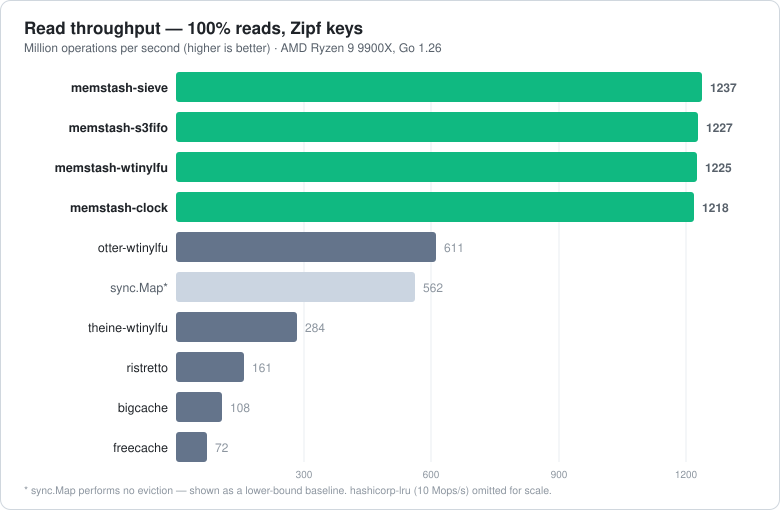

# Memstash

[](https://github.com/zakonnic/memstash/actions/workflows/ci.yml)
[](https://pkg.go.dev/github.com/zakonnic/memstash)
[](https://github.com/zakonnic/memstash/tags)
[](go.mod)
[](LICENSE)

**An unreasonably fast two-level cache for Go — tuned hard at both ends.
Simple by default, deep when you need it.**

Memstash can serve as a pure in-memory cache. It keeps the keys you touch most in your process,
where a read takes nanoseconds instead of a network round trip (and fewer of them with memstash). But
your whole dataset is usually far larger. That's when you add a second level, L2 (Redis or any storage
you want): the same cache now serves all of it from a store every node shares, and stays warm across
restarts. Reads fall back to L2 only on memory misses; writes land in memory immediately and reach L2
in the background.

```go
c, _ := memstash.New[string, string]()
_ = c.Set(ctx, "hello", "world")
v, ok, err := c.Get(ctx, "hello") // faster than a sync.Map lookup
```

## Why memstash?

- **Very fast.** A hit usually costs one memory access, a single 64-byte block; even a plain Go map needs at least
  two. That makes reads the fastest in the [benchmarks](#benchmarks): well ahead of the nearest contender and
  several times ahead of most. Writes keep level with the fastest caches there.
- **Low memory overhead.** An entry lives inline in its table slot, and everything the cache tracks about it fits
  in 16 bytes beside it. That gives the smallest [heap footprint](#heap-footprint-lower-is-better), more than a
  quarter below the next smallest cache. Less overhead means more keys.
- **Easy on the GC.** `Get`, `Set` and `Delete` allocate nothing. The collector sees one large array per shard
  instead of an object per entry.
- **High hit rate.** The default S3-FIFO eviction policy keeps level with the best in the
  [benchmarks](#hit-rate---higher-is-better) and leads under scans and one-hit wonders at small and mid
  capacities. You can switch to any of the other built-in policies, or plug in your own, to get the most out of
  your workload.
- **Second-level cache out of the box.** Put a shared store such as Redis behind the in-memory cache, or memory in
  front of the Redis you already use. It is one call either way, and you get a cache that is as fast as memory,
  shared between nodes and warm after a restart.
- **Adapters included.** Ready-made L2 adapters for Redis, memcached, SQL/PostgreSQL, MongoDB,
  DynamoDB, Badger, Tarantool and Aerospike — each in its own module so the core stays clean. With
  **write-back** and **auto-batching**.
- **Singleflight built in.** `GetOrLoad` collapses a stampede of concurrent misses on one key into a
  single load.

## Table of Contents

- [Why memstash?](#why-memstash)
- [Installation](#installation)
- [Usage](#usage)
  - [In-memory cache](#in-memory-cache)
  - [Read-through with a loader (singleflight)](#read-through-with-a-loader-singleflight)
  - [Two-level cache with Redis](#two-level-cache-with-redis)
- [Advanced Configuration](#advanced-configuration)
- [Full option list](#full-option-list)
- [L2 Adapters](#l2-adapters)
- [Benchmarks](#benchmarks)
  - [Throughput](#throughput---nsop-lower-is-better)
  - [Parallel throughput](#parallel-throughput---millions-of-opss-higher-is-better)
  - [Hit rate](#hit-rate---higher-is-better)
  - [Heap footprint](#heap-footprint-lower-is-better)
  - [Load generator](#load-generator)
- [Contributing](#contributing)
- [License](#license)

## Installation

```sh
go get github.com/zakonnic/memstash
```

Memstash requires Go 1.24+ and has a single core dependency
([xsync](https://github.com/puzpuzpuz/xsync)). Client SDKs are pulled in only by the specific L2
adapter module you import. It builds for every Go port. On mips and on arm before ARMv7 the runtime emulates 64-bit
atomics with a lock, so reads there are correct but not lock-free.

## Usage

### In-memory cache

The simplest setup: a bounded, in-process cache with no external dependencies.

```go
package main

import (
	"context"
	"fmt"

	"github.com/zakonnic/memstash"
)

func main() {
	ctx := context.Background()

	// Capacity is measured in weight units; without a cost function every item
	// weighs 1, so this holds 100k entries. An unconfigured cache defaults to 20k.
	c, err := memstash.New[string, string](
		memstash.WithMemoryCapacity(100_000),
	)
	if err != nil {
		panic(err)
	}

	_ = c.Set(ctx, "greeting", "hello")
	if v, ok := c.GetFromMemory("greeting"); ok { // fastest read path: no locks, no allocations
		fmt.Println(v) // hello
	}
}
```

> Every method is safe to call from any number of goroutines.

### Read-through with a loader (singleflight)

The most common caching pattern: on a miss, load from the source of truth. Concurrent misses on the
same key are automatically **coalesced into a single load**.

```go
c, _ := memstash.New[string, User](
	memstash.WithTTL(5*time.Minute),
)

user, err := c.GetOrLoad(ctx, "user:42", func(ctx context.Context, key string) (User, error) {
	return db.FindUser(ctx, key) // runs once even under a stampede
})
```

A loader returns `memstash.ErrKeyNotFound` for a key the source does not have: nothing is cached, and `GetOrLoad`
returns that error. A batch loader just leaves the key out.

Prefer to fix the loader once at construction time? Use `NewLoadable`:

```go
lc, _ := memstash.NewLoadable(
	func(ctx context.Context, id string) (User, error) { return db.FindUser(ctx, id) },
)
user, err := lc.GetOrLoad(ctx, "user:42")
```

> Supports batch-loading with `NewBatchLoadable`, `BatchGetOrLoad`, etc.

### Two-level cache with Redis

Add a shared L2 in one call. Memory serves the hot set; anything evicted from L1 (the in-memory level)
or missing after a restart is fetched from Redis and promoted back into memory. Writes are **write-back by default**:
`Set` returns immediately and a background worker flushes to Redis. Single **Sets are grouped into
batches** asynchronously. The example uses rueidis, but every client in the [adapters
table](#l2-adapters) works the same way.

```go
import (
	"github.com/redis/rueidis"

	"github.com/zakonnic/memstash"
	rueidis_adapter "github.com/zakonnic/memstash/l2/rueidis_adapter"
)

client, _ := rueidis.NewClient(rueidis.ClientOption{
	InitAddress: []string{"127.0.0.1:6379"},
})

// JSON values, string keys, 10-minute TTL applied to both levels (L1 uses the default capacity).
c, _ := rueidis_adapter.NewJSONCache[string, User](client, memstash.WithTTL(10*time.Minute))
defer c.Close() // waits for the write-back buffer to drain

_ = c.Set(ctx, "user:42", user)     // L1 now, Redis shortly after (write-back)
u, ok, err := c.Get(ctx, "user:42") // L1 hit → returns instantly; L1 miss → Redis, then promoted
```

> Tip: A common way to shard local caches without overlap is to key them by the Kafka partition —
> each partition is consumed by exactly one node, so the cache for a given object lives only on that
> node.

## Advanced Configuration

Memstash is configured with functional options passed to `New` (or to any adapter's `New*Cache`).
Some common setups:

**Byte-budgeted cache** — bound by the byte size of stored data instead of item count; the per-item
size (key and value bytes) is estimated automatically:

```go
c, _ := memstash.New[string, []byte](
	memstash.WithMemoryBudget(512 << 20), // ~512 MiB of keys and values
)
```

The budget is a bound: memstash derives its capacity from it and grows into it rather than
allocating a fixed block up front.

The built-in estimator covers types whose size is trivial to compute: numerics, pointer-free
structs/arrays, strings, slices of fixed-size elements, and pointers to fixed-size types. For
anything more complex, construction fails with `ErrBudgetNeedsCostFunc` — provide the byte size
yourself:

```go
c, _ := memstash.New[string, User](
	memstash.WithMemoryBudget(512 << 20),
	memstash.WithCostFunc(func(k string, u User) uint32 { return uint32(len(k) + u.Bytes()) }),
)
```

**Synchronous writes on Set** — write-through policy, L2 updated synchronously:

```go
c, _ := rueidis_adapter.NewJSONCache[string, Session](client,
	memstash.WithWritePolicy(memstash.WriteThrough),
)
```

**Batch operations** — amortize the network round trip; adapters use native pipelining / multi-get
where the client supports it:

```go
found, err := c.BatchGet(ctx, []string{"a", "b", "c"})            // one round trip to L2 for the misses
dst = c.BatchGetFromMemory([]string{"a", "b"}, dst)
err = c.BatchSet(ctx, memstash.List[string, User]{{Key: "a", Value: a}, {Key: "b", Value: b}})
err = c.BatchDelete(ctx, []string{"a", "b"})                      // follows the write policy, like BatchSet
```

**Coalesced reads** — `GetBatched` can be used instead of `Get`; it works the same, but adds batching like `Set`'s:
an L1 miss that should go to L2 joins a queue shared by all callers, and a worker pool fetches everything waiting
there in a single `BatchGet` — so a key several goroutines want right then is read once. The caller waits longer,
but total throughput goes up. Worth it where the client has no pipelining of its own (go-redis, `database/sql`).
With an auto-pipelining client (rueidis, valkey), plain `Get` stays ahead — it already packs concurrent commands
onto one connection. The worker pool starts lazily on first call.

```go
u, ok, err := c.GetBatched(ctx, "user:42") // L1 hit → instant; a miss rides one BatchGet with other misses
```

**Observability and iteration** — `Stats()` returns operation counters (collected with striped
counters, so an increment stays contention-free even under heavy parallelism). It's opt-in via
`WithStats()`: off by default so a cache that doesn't read `Stats()` doesn't pay for it. Without it,
the counters stay at zero. `Iterator()` walks the live first-level entries lock-free, independent of
stats:

```go
c, _ := memstash.New[string, User](
	memstash.WithStats(),
)
s := c.Stats() // s.Hits(), s.Misses(), s.Sets(), s.Deletes(), s.Rejected(), s.HitRate(), s.MissRate(), ...
for key, value := range c.Iterator() {
	fmt.Println(key, value)
}
```

**Removal events** — get told when an item leaves memory, and why. Handlers run after the shard lock
is released, so they may take their time and may call back into the cache; a small cost per removal
when a handler is set, otherwise zero overhead:

```go
c, _ := memstash.New[string, *Conn](
	memstash.WithOnDeletion(func(key string, conn *Conn, cause memstash.DeletionCause) {
		deletions++ // cause is one of invalidation, replacement, expiration, eviction, overflow
	}),
)
```

Interested only in the cache's own decisions — expiration, eviction and overflow? Gate the handler
on `cause.Automatic()`.

**Snapshots** — dump the hot set to a file on shutdown and start warm instead of cold. `SaveTo`
streams every live item through the codecs you give it; `LoadFrom` reads it back through the normal
write path, so the capacity, the cost function and the eviction policy all still apply:

```go
f, _ := os.Create("cache.snapshot")
_ = c.SaveTo(f, l2.StringCodec(), l2.JSONCodec[User]()) // keys and values get their own codec
_ = f.Close()

// ...on the next start
f, _ = os.Open("cache.snapshot")
_ = c.LoadFrom(ctx, f, l2.StringCodec(), l2.JSONCodec[User](), memstash.LoadWithTTL)
```

Loading takes options:

| Option | Effect |
|---|---|
| `LoadWithCurrentTTL` | Every item gets a full, fresh lifetime, exactly as `Set` would. The default. |
| `LoadWithTTL` | Expirations are restored on their original schedule: the snapshot records what each item had left plus the moment it was taken, so time spent in the file counts and items already past their deadline are skipped. Capped at the loading cache's own TTL; a cache without one keeps the items without expiry. With `LoadToL2`, L2 gets the same lifetime. |
| `LoadToL2` | Also write every loaded item to the second level, following `WritePolicy`. |

Without `LoadToL2` only the first level is touched, and `ctx` goes unused. A truncated or foreign
file is rejected with `ErrBadSnapshot`.

**Non-string keys with a custom key mapping** — provide a key function for the L2 storage key:

```go
c, _ := rueidis_adapter.NewJSONCache[int, User](client,
	l2.WithKeyFunc(func(id int) string { return "user:" + strconv.Itoa(id) }),
)
```

**Ordered MGET** — on the Redis-family adapters `BatchGet` reads the MGET reply array positionally
when every key of a batch lands on the same server, which drops the key-to-reply map (fewer
bytes allocated per `BatchGet`). Adapters probe the client for it by default; override the probe
when you know better — for example a cluster client whose batches stay inside one slot:

```go
c, _ := rueidis_adapter.NewJSONCache[string, User](client,
	l2.WithOrderedMget(memstash.Enabled),
)
```

Asserting `Enabled` on a client that fans a batch across nodes pairs values with the wrong keys, so
leave it at `memstash.AutoDetect` unless the topology is yours to guarantee.

**Custom serializer** — `NewCache` takes any `memstash.Codec[V]`, so a binary format works just as
well as JSON. You can encode each field directly instead of going through JSON:

```go
type Point struct {
	X, Y float64
}

type pointCodec struct{}

func (pointCodec) Marshal(p Point) ([]byte, error) {
	buf := make([]byte, 16)
	binary.LittleEndian.PutUint64(buf[0:8], math.Float64bits(p.X))
	binary.LittleEndian.PutUint64(buf[8:16], math.Float64bits(p.Y))
	return buf, nil
}

func (pointCodec) Unmarshal(data []byte) (Point, error) {
	return Point{
		X: math.Float64frombits(binary.LittleEndian.Uint64(data[0:8])),
		Y: math.Float64frombits(binary.LittleEndian.Uint64(data[8:16])),
	}, nil
}

c, err := rueidis_adapter.NewCache[int, Point](client, pointCodec{},
	l2.WithKeyFunc(strconv.Itoa),
)
```

**Eviction policies** — four built-ins, selected with `WithPolicy`:
[`PolicyS3FIFO`](https://s3fifo.com/) (the default: quarantine + protected queue + ghost, the best
all-rounder under scans and one-hit wonders),
[`PolicyClock`](https://en.wikipedia.org/wiki/Page_replacement_algorithm#Clock) (GCLOCK,
approximates LRU at FIFO cost), [`PolicyWTinyLFU`](https://arxiv.org/abs/1512.00727) (an admission
window gated by a Count-Min frequency sketch that remembers keys across evictions — strong on skewed
workloads), and [`PolicySIEVE`](https://sievecache.com/) (a single scan hand over the insertion
order — the simplest, with an S3-FIFO-class hit rate). All share the same lock-free read path: a
read only sets a 2-bit reference counter on the item's meta word.

**Custom eviction policy** — implement the `memstash.EvictionPolicy` interface (the same contract
the built-ins use: `Add`/`Remove`/`Reweigh`/`Evict`/`Bytes`, all called under the shard mutex). The
cache enqueues every new item at the back of queue 0 and removes every departing one; the policy
moves items between the `EvictionQueues` queues threaded through the shard's table
(`Items.Oldest`/`Newer`/`Requeue`, a scan `Hand`) and names the victim by its slot index. Plug its
per-shard factory in:

```go
c, err := memstash.New[string, User](
	memstash.WithCustomEvictionPolicy(func(items memstash.Items[string, User], shardCap int64) memstash.EvictionPolicy[string, User] {
		return newMyPolicy(items, shardCap) // items is the shard's table: its items and eviction queues
	}),
)
```

A custom policy changes the hit rate: you decide which items stay and which are evicted, for instance by looking
at the items themselves.

## Full option list

| Option | Purpose |
|---|--------------|
| `WithMemoryCapacity(n)` | L1 capacity in weight units (defaults to 20k). |
| `WithMemoryBudget(bytes)` | L1 bound in bytes of stored keys and values; derives a size-based cost function automatically (mutually exclusive with `WithMemoryCapacity`). |
| `WithCostFunc(fn)` | Per-item weight function (e.g. size in bytes). |
| `WithTTL(d)` | Item lifetime (1-second resolution up to ~36h, proportionally coarser above that); applied to L2 writes too. Required for `SetWithTTL`. |
| `WithRefreshTTLOnGet()` | Sliding expiration: every L1 hit extends the item by a full `WithTTL` lifetime — including entries written with `SetWithTTL`. |
| `WithPolicy(p)` | `PolicyS3FIFO` (default), `PolicyClock`, `PolicyWTinyLFU`, or `PolicySIEVE`. |
| `WithCustomEvictionPolicy(fn)` | Plug in your own eviction policy: a per-shard factory returning a `memstash.EvictionPolicy` implementation. |
| `WithPreallocatedSize()` | Allocate every shard's item table up front, at the size filling to capacity would grow it to anyway. Such a table never grows afterwards. Recommended for large caches: a table grown from empty copies every item about five times on its way to capacity. Not available with `WithCostFunc` / `WithMemoryBudget`. |
| `WithPreallocationRatio(r)` | How full a preallocated table sits at capacity, `0 < r < 1` (default `DefaultPreallocationRatio`, 0.75). Preallocates on its own. Denser packs tighter and walks further: (1 + 1/(1-r))/2 slots per hit, 2.5 at 0.75. The table holds live items only, so that is the walk the cache keeps. |
| `WithGrowthThreshold(t)` | Occupancy (live items over slots) a non-preallocated shard table grows at, `0 < t < 1` (default `DefaultGrowthThreshold`, 5/6). A preallocated table never grows. |
| `WithShardsCount(n)` | Number of eviction shards (default: auto by GOMAXPROCS). |
| `WithL2Cache(l2)` | Attach a second level directly. |
| `WithWritePolicy(p)` | How writes reach L2, ignored when no L2 is attached: `WriteBack` (default) hands `Set` to the background worker pool, `WriteThrough` writes on `Set` and returns the L2 error, `WriteDisabled` makes L2 read-only. Deletes follow the same policy as writes. |
| `WithWriteBackBuffer(n)` | Size of the async write-back buffer for every worker (default: 500). A write that finds it full waits for room, so the writes of one key reach L2 in order. |
| `WithWriteBackWorkers(n)` | Number of goroutines draining the write-back buffers (default: 4). Each key belongs to one worker, so its L2 writes keep their order; each worker has its own buffer, and batching happens within it. |
| `WithBatchingForWriteBack()` / `WithNoBatchingForWriteBack()` / `WithAdaptiveBatchingForWriteBack()` | How a write-back worker drains its buffer share to L2: coalesced into `BatchSet` (default), one `Set` per write, or adaptive. |
| `WithGetBatchedBuffer(n)` | Size of the worker pool buffer queue `GetBatched` coalesces L2 reads through (default: 1024). |
| `WithGetBatchedWorkers(n)` | Number of goroutines resolving the coalesced reads (default: 4), and with that the number of `BatchGet` calls in flight. A batch only forms while every worker is busy, so fewer workers mean fuller batches. |
| `WithGhostSize(n)` | Capacity (in keys) of the S3-FIFO ghost queues and the W-TinyLFU frequency sketch. |
| `WithOnL2Error(fn)` | Handler for background L2 errors. Write-back errors arrive on the worker goroutine: the handler must not write to the cache. |
| `WithOnDeletion(fn)` | Handler for every item leaving L1, with the cause (`CauseInvalidation`, `CauseReplacement`, `CauseExpiration`, `CauseEviction`, `CauseOverflow`). |
| `WithPanicHandler(fn)` | Handler for the panics the cache recovers on its own goroutines and around a background loader. Receives what `recover()` returned and whether the panic was passed on (to `OnL2Error`, or to waiters as `ErrLoaderPanic`); `false` means the handler is its only trace. Must not write to the cache. |
| `WithStats()` | Enables the `Stats()` operation counters. Off by default. |

## L2 Adapters

Each adapter is a separate module (`memstash/l2/<name>_adapter`) so the core never pulls in a client
SDK you don't use. Every adapter offers both an "adapter only" constructor (`New`, `NewJSON`,
`NewBytes`) and an all-in-one two-level constructor (`NewCache`, `NewJSONCache`, `NewBytesCache`),
plus native batch pipelining where the client supports it.

The write path favors throughput by default: instead of one round trip per key, each background
write-back worker coalesces the Sets into the adapter's native `BatchSet` call (an `MSET` or a pipeline).

| Module | Backend / client | context |
|---|---|---|
| `l2/goredis_adapter` | Redis — [redis/go-redis](https://github.com/redis/go-redis) | ✅ |
| `l2/rueidis_adapter` | Redis — [redis/rueidis](https://github.com/redis/rueidis) | ✅ |
| `l2/valkey_adapter` | Valkey — [valkey-io/valkey-go](https://github.com/valkey-io/valkey-go) | ✅ |
| `l2/redispipe_adapter` | Redis — [joomcode/redispipe](https://github.com/joomcode/redispipe) | ✅ |
| `l2/redigo_adapter` | Redis — [gomodule/redigo](https://github.com/gomodule/redigo) | partial |
| `l2/gomemcache_adapter` | memcached — [bradfitz/gomemcache](https://github.com/bradfitz/gomemcache) | ❌ |
| `l2/rainycape_adapter` | memcached — [rainycape/memcache](https://github.com/rainycape/memcache) | ❌ |
| `l2/mc_adapter` | memcached, one server — [memcachier/mc](https://github.com/memcachier/mc) | ❌ |
| `l2/sql_adapter` | any [database/sql](https://pkg.go.dev/database/sql) engine (SQLite, MySQL, ...) | ✅ |
| `l2/pgx_adapter` | PostgreSQL — [jackc/pgx](https://github.com/jackc/pgx) (native, pipelined) | ✅ |
| `l2/badger_adapter` | embedded — [dgraph-io/badger](https://github.com/dgraph-io/badger) | ❌ |
| `l2/mongo_adapter` | MongoDB — [mongo-driver](https://github.com/mongodb/mongo-go-driver) | ✅ |
| `l2/dynamo_adapter` | DynamoDB — [aws-sdk-go-v2](https://github.com/aws/aws-sdk-go-v2) | ✅ |
| `l2/tarantool_adapter` | Tarantool — [go-tarantool](https://github.com/tarantool/go-tarantool) | ✅ |
| `l2/aerospike_adapter` | Aerospike — [aerospike-client-go](https://github.com/aerospike/aerospike-client-go) | ❌ |

Each adapter takes an interface rather than a concrete client, so it stays independent of the client
library's version, and a few libraries are covered without a separate module: `sql_adapter` accepts
any `{QueryContext, ExecContext}` (so pgx via database/sql works too), `badger_adapter` covers
[badgerhold](https://github.com/timshannon/badgerhold) via `store.Badger()`, and `dynamo_adapter`
covers [guregu/dynamo](https://github.com/guregu/dynamo) via its underlying `*dynamodb.Client`.

Stores without server-side expiration filter expired entries on read. The SQL adapters (`sql_adapter`,
`pgx_adapter`) expose a reaper (`DeleteExpired`) to purge them; Tarantool leaves that to its
`expirationd` module. The note in each package doc explains the specifics.

Rolling your own is straightforward: implement the `memstash.L2Cache[K, V]` interface
(`Get`/`BatchGet`/`Set`/`BatchSet`/`Delete`/`BatchDelete`) and pass it to `WithL2Cache`.

## Benchmarks

[Measured](benchmarks/results/out.txt) on an AMD Ryzen 9 9900X (Go 1.26.4). Reproduce with:

```sh
make bench

# make help # List all commands and benchmarks
```

Configuration for all of them lives in [benchmarks/adapters.go](benchmarks/adapters.go). In the tables, bold marks a
memstash result ahead of every other cache in its column.



### Throughput - ns/op, lower is better

| Cache | GetHit | Get (50% hit rate) | Set | 90 Get / 10 Set | Set alloc |
|---|--:|------------------:|--:|----------------:|--:|
| **memstash-s3fifo** | **0.74** |          **0.86** | 24.5 |        **2.33** | 0 B / 0 |
| **memstash-clock** | **0.76** |          **0.88** | 29.8 |        **2.26** | 0 B / 0 |
| **memstash-wtinylfu** | **0.77** |          **0.86** | 23.0 |        **2.19** | 0 B / 0 |
| **memstash-sieve** | **0.76** |          **0.88** | 30.4 |        **2.24** | 0 B / 0 |
| otter-wtinylfu | 1.55 |              1.35 | 50.0 |            3.92 | 23 B / 0 |
| theine-wtinylfu | 3.56 |              3.30 | 328.1 |           51.56 | 43 B / 0 |
| ristretto | 6.13 |              6.22 | 120.4 |           20.85 | 85 B / 1 |
| bigcache | 9.02 |              7.25 | 36.6 |           20.99 |  8 B / 1 |
| freecache | 13.90 |             11.73 | 20.9 |           14.22 |  0 B / 0 |
| hashicorp-lru | 95.09 |             88.65 | 131.3 |           99.78 | 61 B / 0 |
| sync.Map\* | 1.77 |              1.78 | 12.7 |            4.29 | 63 B / 2 |

\* `sync.Map` performs no eviction — a lower-bound baseline, not a comparable cache.

### Parallel throughput - millions of ops/s, higher is better

| Cache | 100% reads | 75% reads | 50% reads | 25% reads | 0% (writes only) |
|---|--:|--:|--:|--:|-----------------:|
| **memstash-s3fifo** | **1227** | **242** | **151** | **115** |               88 |
| **memstash-clock** | **1218** | **241** | **153** | **114** |               65 |
| **memstash-wtinylfu** | **1225** | **242** | **148** | **110** |           **95** |
| **memstash-sieve** | **1237** | **245** | **152** | 101 |               93 |
| otter-wtinylfu | 611 | 180 | 127 | 109 |               94 |
| theine-wtinylfu | 284 | 10 | 6.1 | 4.5 |              3.4 |
| ristretto | 161 | 19 | 9.5 | 6.2 |              4.7 |
| bigcache | 108 | 35 | 27 | 25 |               28 |
| freecache | 72 | 69 | 67 | 66 |               64 |
| hashicorp-lru | 9.9 | 9.9 | 10 | 9.8 |              9.1 |
| sync.Map\* | 562 | 155 | 107 | 82 |               75 |

### Hit rate - higher is better

**Capacity = 500k items (~36% of the working set):**

| Cache | Zipf | Zipf+scan | One-hit 30% |
|---|--:|--:|--:|
| ristretto | 58.31% | 35.38% | 37.01% |
| **memstash-s3fifo** | 58.12% | 34.72% | 36.39% |
| **memstash-wtinylfu** | 58.11% | 34.92% | 36.63% |
| **memstash-sieve** | 57.73% | 34.12% | 35.85% |
| theine-wtinylfu | 57.30% | 34.44% | 35.66% |
| **memstash-clock** | 57.07% | 33.08% | 34.65% |
| otter-wtinylfu | 56.63% | 33.77% | 34.91% |
| hashicorp-lru | 55.64% | 31.61% | 32.99% |
| freecache | 52.10% | 28.22% | 29.03% |
| bigcache | 51.29% | 27.95% | 29.23% |

**Capacity = 100k items (~7% of the working set):**

| Cache | Zipf | Zipf+scan | One-hit 30% |
|---|--:|--:|--:|
| **memstash-wtinylfu** | **41.84%** | **26.30%** | **27.05%** |
| **memstash-s3fifo** | **41.11%** | **26.33%** | **27.18%** |
| theine-wtinylfu | 41.03% | 25.96% | 26.46% |
| otter-wtinylfu | 40.13% | 25.31% | 25.83% |
| **memstash-sieve** | 39.62% | 25.20% | 25.14% |
| ristretto | 39.09% | 23.55% | 24.86% |
| **memstash-clock** | 33.11% | 18.22% | 18.93% |
| hashicorp-lru | 30.03% | 15.62% | 16.53% |
| bigcache | 28.26% | 15.71% | 15.48% |
| freecache | 25.75% | 14.48% | 14.00% |

**Capacity = 10k items (~1% of the working set):**

| Cache | Zipf | Zipf+scan | One-hit 30% |
|---|--:|--:|--:|
| theine-wtinylfu | 15.36% | 9.24% | 10.22% |
| otter-wtinylfu | 14.81% | 8.57% | 8.84% |
| **memstash-s3fifo** | 14.75% | **9.88%** | **10.27%** |
| **memstash-wtinylfu** | 14.47% | 8.34% | 8.62% |
| **memstash-sieve** | 13.48% | 8.86% | 8.86% |
| bigcache | 11.75% | 7.46% | 6.09% |
| ristretto | 10.16% | 5.62% | 5.39% |
| freecache | 6.00% | 3.93% | 3.03% |
| **memstash-clock** | 5.34% | 3.50% | 2.62% |
| hashicorp-lru | 5.01% | 3.30% | 2.49% |

### Heap footprint, lower is better

Each cache is filled with 100M `uint64 -> uint64` entries — 16 bytes of raw payload apiece — and the
heap growth it causes is read back from the Go runtime, so these are real resident bytes rather than
an estimate. The [measurements](benchmarks/results/heap-size-100kk.txt) run one
contender at a time: a single pass costs several GiB. The caches that only accept byte-slice or
string keys were given the same keys converted to `[8]byte`. Reproduce with `make bench-100kk`
(memstash) and `make bench-100kk-others`.

| Cache | Heap | B/entry |  Get hot | Get full | Set hot | Set full |
|---|--:|--:|---------:|--:|--:|--:|
| xsync.MapOf\* | 3.7 GiB | 39.24 |    1.60 ns | 9.71 ns | 5.61 ns | 15.29 ns |
| **memstash-s3fifo** | **4.1 GiB** | **43.72** |    3.17 ns | **9.66 ns** | 12.19 ns | 19.10 ns |
| bigcache | 5.4 GiB | 59.92 |    15.59 ns | 22.41 ns | 55.49 ns | 63.25 ns |
| freecache | 5.7 GiB | 61.53 |    40.32 ns | 49.31 ns | 41.78 ns | 51.91 ns |
| otter-wtinylfu | 7.6 GiB | 81.99 |     3.07 ns | 13.41 ns | 10.80 ns | 17.65 ns |
| hashicorp-lru | 9.7 GiB | 104.2 |    167.8 ns | 524.9 ns | 203.0 ns | 520.6 ns |
| theine-wtinylfu | 11 GiB | 115.0 |     9.54 ns | 19.46 ns | 371.0 ns | 494.9 ns |
| ristretto | 14 GiB | 153.1 |    17.19 ns | 22.71 ns | 275.5 ns | 294.5 ns |

\* `xsync.MapOf` performs no eviction — a lower-bound baseline, not a comparable cache. Switched from sync.Map: it
uses too much memory.

The four latency columns are measured on that same filled cache, so they show what a read and a
write cost at 100M entries rather than at a benchmark-sized capacity. **hot** replays a 64k-key
window from the middle of the fill: it stays in CPU cache and measures the code path itself.
**full** draws uniformly over all 100M keys, so nearly every op is an LLC and a TLB miss — the gap
between the two columns is what memory stalls cost per op at this cardinality. Both are aggregate
ns/op across all cores, like the parallel table above.

### Load generator

A long-running soak test lives [in benchmarks](benchmarks/load_generator) (run `make load-generator`). It hammers
three independently configured caches with continuous, realistic load to verify correctness and measure
real-world hit rates under sustained pressure.

Three parallel scenarios, each with its own cache, goroutines, and key space:

| | Values | Capacity               | Key space              | L2 | Mix | Load                                         |
|---|---|------------------------|------------------------|---|---|----------------------------------------------|
| `scenario-1` | web sessions, ~170–490 B | 100k items             | 150M read / 100M written | none | 90% Get | 10 goroutines, 1M rps total                  |
| `scenario-2` | CDN assets, 0.6–64 KiB | 20k items              | 10M                    | Redis cluster, 3 nodes (rueidis) | 50/50 | 5 goroutines, 100k rps total                 |
| `scenario-3` | DB rows, ~250 B | ~10 MB (cost-weighted), ~37k rows | 20M                    | Valkey, 1 node (valkey-go) | 90% Get | 40 goroutines, 1 hot (10k rps) + 30k rps shared |

Keys follow a Zipf distribution (`zipf_s` 1.001–1.05) over a key space orders of magnitude larger than L1 capacity,
plus a 10% `random_percent` share drawn uniformly instead.

**Every Get is verified** against what the scenario's `Value` function returns for that key —
`load_generator.WithNoVerification()` turns that off when you want the load without the check. Everything that
can go wrong lands in `errors.log`.
Logged once per minute + on shutdown (`scenario-N.log`, JSON lines).
Tuning via [config.yaml](benchmarks/load_generator/config.yaml). All fields optional; `-config` repeats, a later file
overriding the fields it sets.
On Docker Desktop, run the L2 scenarios with `make load-generator-docker`: the generator then runs in compose next to
the servers instead of going through the port relay, which adds milliseconds to every L2 round trip. Logs land in
`benchmarks/bin/docker`.

It's a standalone module, so the same engine can run your own scenarios — the three above
live in [cmd/load-generator](benchmarks/load_generator/cmd/load-generator) and are nothing but a
`[]Scenario[K, V]`. You can use it as an example and create the app with `load_generator.New`.

**What you can check:**
- **Correctness** — empty `errors.log` after hours of 1M+ rps
- **Real hit rates** — configure `size`, `key_space`, `zipf_s` to match your service
- **L1 vs L2 split** — traffic reaching Redis, L2 hit rate under working set rotation
- **Memory/goroutine stability** — flat metrics over hours = no leaks
- **Load cost** — `process_cpu_cores` at target rps
- **Throughput ceilings** — `ops_per_sec` below the start line's `target_rps` reveals bottlenecks
- **Adapter comparison** — same scenario, same load, another `l2_client_type`
- **Pre-production testing** — point `address` at staging

## Contributing

Bug reports and focused pull requests are welcome — see [CONTRIBUTING.md](CONTRIBUTING.md) for the
repository layout, the test and lint commands, and the benchmarking rules that apply to changes on
the hot path. Notable changes are recorded in the [changelog](CHANGELOG.md); security reports go
through the [security policy](SECURITY.md).

## License

[Apache 2.0](LICENSE)
